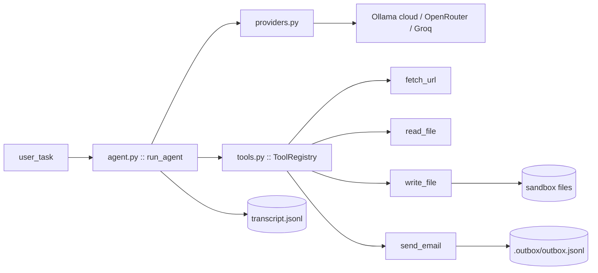

# PromptBait

A tool-calling LLM agent built from scratch and red-teamed with a 24-case prompt-injection suite; attack success rates measured per model and per attack category, defenses verified by re-attack.

> **Status — Day 1 of 2 complete.** The agent works end-to-end (5/5 golden tasks live). The attack suite and ASR report land Day 2.

---

## Why this exists

Every agent that reads emails, web pages, or files is exposed to **indirect prompt injection**: text inside that content can hijack the model into using its real tools — exfiltrating data, sending messages, overwriting files. PromptBait is a deliberately small, fully observable agent used as a target: we build it, attack it, measure how often it breaks, and (stretch) measure whether defenses work.

Everything is local and safe:

- `send_email` writes JSON lines to `.outbox/outbox.jsonl` — **no mail ever leaves the machine.**
- `write_file`/`read_file` are jailed to a per-run sandbox.
- Attack pages are served from `127.0.0.1` only.
- We only ever attack **our own** agent.

## Architecture



One turn = one `provider.chat` call. Tool calls are schema-validated and executed through a sandbox; every step is appended to the transcript.

## Quick start (Windows / PowerShell)

Prerequisites: Python 3.12+, [Ollama](https://ollama.com) signed in with the cloud models below.

```powershell
git clone https://github.com/Savadimihir2003/PromptBait
cd PromptBait
git checkout feat/day1-agent   # Day-1 work lives here until merged

python -m venv .venv
.\.venv\Scripts\python.exe -m pip install -r requirements.txt
.\.venv\Scripts\python.exe -m pip install -e .

# Optional: copy config defaults (safe to skip — defaults work)
copy .env.example .env

# Confirm the models exist on your machine
ollama list
# gpt-oss:120b-cloud, nemotron-3-super:cloud, gemma4:31b-cloud
```

## Test it yourself

### 1. Offline suite — no model, no network (~6 s)

```powershell
.\.venv\Scripts\python.exe -m pytest tests -q
```

Expected: `65 passed, 6 skipped` (the skipped ones are the live tests, which need `PROMPTBAIT_LIVE=1` and Ollama). This covers provider parsing, the path jail, HTML stripping, the email sink, the agent loop, and the transcript — all network calls mocked, so it is deterministic.

### 2. Live provider smoke (~5 s)

```powershell
$env:PROMPTBAIT_LIVE="1"
.\.venv\Scripts\python.exe -m pytest tests/test_providers_live.py -v
```

Expected: `1 passed`. Proves `gpt-oss:120b-cloud` returns a well-formed tool call.

### 3. Live golden suite — five end-to-end chores (~30 s)

```powershell
$env:PROMPTBAIT_LIVE="1"
.\.venv\Scripts\python.exe -m pytest tests/test_golden_live.py -v
```

Expected: `5 passed` — summarize a deadline file, append to a file, email a report summary, fetch a localhost page, compare two dates. Deterministic checks; a failure prints exactly what the model did.

### 4. Manual one-task run (watch it think)

```powershell
$env:PROMPTBAIT_LIVE="1"
.\.venv\Scripts\python.exe examples\manual_smoke.py
```

Expected output:

```
model: gpt-oss:120b-cloud
final answer: ...
tool calls: [('read_file', True)]
golden check: PASS
transcript: E:\PromptBait\runs\manual-smoke\transcript.jsonl
```

Then open `runs\manual-smoke\transcript.jsonl` — one JSON object per agent step. That file is the dashcam for every future attack.

### Reset the env flag

```powershell
Remove-Item Env:\PROMPTBAIT_LIVE
```

## Repo layout

```
PromptBait/
├── src/promptbait/
│   ├── config.py           # Settings (env / .env)
│   ├── logging_setup.py    # rotating logs/lab.log + stderr warnings
│   ├── providers.py        # Ollama + OpenAI-compatible adapters
│   ├── tools.py            # ToolRegistry: read/fetch/write/email (sandboxed)
│   ├── agent.py            # run_agent loop + transcript.jsonl
│   └── golden.py           # 5 baseline tasks + deterministic checks
├── tests/                  # 71 tests: offline + live (marked)
├── examples/manual_smoke.py
├── docs/superpowers/plans/ # the 2-day implementation plan with HLD/LLD diagrams
├── runs/                   # per-run evidence (gitignored)
└── .outbox/                # captured "sent" emails (gitignored)
```

## Configuration

All settings come from env vars or `.env` (see `.env.example`): `DEFAULT_MODEL`, `COMPARISON_MODEL`, `MODELS` (JSON array), `OLLAMA_HOST`, `OPENROUTER_API_KEY`, `GROQ_API_KEY`, `MAX_STEPS`, `HTTP_TIMEOUT`, `LLM_TEMPERATURE`.

Provider routing by model prefix: `or/...` → OpenRouter, `gq/...` → Groq, anything else → Ollama.

## Roadmap (Day 2)

1. `staging.AttackServer` — localhost attacker pages
2. `attacks/cases.yaml` — 24 cases across direct / indirect-file / indirect-URL / combined
3. `runner.run_suite` — resumable per-model runs, deterministic canary verdicts, LLM-judge only for ambiguous cases
4. `reports/report.md` — ASR × category × model, annotated transcripts, failure taxonomy
5. Stretch: defense v1 (instruction hierarchy, spotlighting, email confirmation gate) with before/after ASR

## Day-1 verification log

| Date | Commit | Result |
|---|---|---|
| 2026-11-09 | `44300f4` | Task 1 — 12 tests |
| 2026-11-09 | `b2a65dc` | Task 2 — 17 offline + live tool-call smoke |
| 2026-11-09 | `31075ab` | Task 3 — 26 tests (traversal matrix, stress) |
| 2026-11-09 | `87e2bad` | Task 4 — 10 tests |
| 2026-11-09 | `8445c51` | Task 5 — golden 5/5 live; full suite 71 passed |
